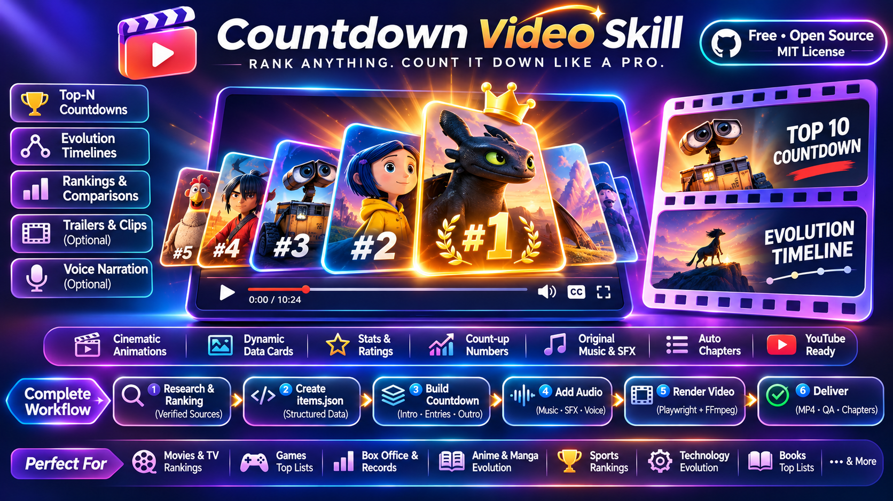
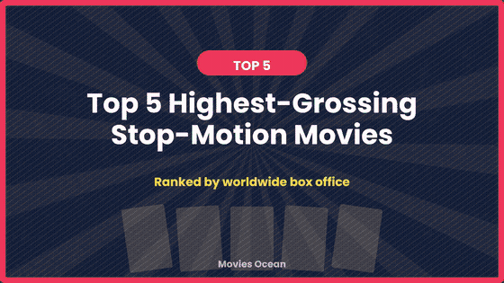
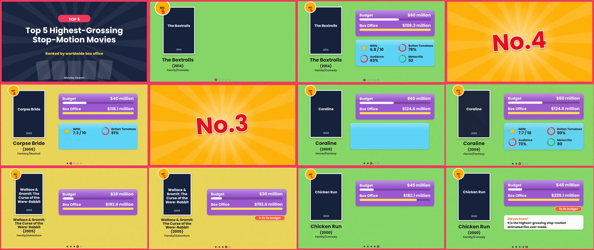

# Countdown Video Skill (हिंदी गाइड)

[](https://github.com/i-smiling-buddha/countdown-video-skill/stargazers)
[](LICENSE)
[](https://agentskills.io)
[](https://skills.sh/i-smiling-buddha/countdown-video-skill)



**कुछ भी rank कीजिए, pro की तरह countdown बनाइए।**

> Top-N countdown और साल-दर-साल "evolution" videos: research, animation और render, सब आपका AI agent करता है।

English: [README.md](README.md)

क्या आप list channel चलाते हैं ("Top 10 highest-grossing…", "Pixar evolution 1995–2024")? यह open-source Agent Skill किसी भी topic को तैयार 1080p MP4 में बदल देती है। आपका agent sources के साथ ranking research करता है और `items.json` लिखता है। फिर engine intro, हर entry से पहले "No.X" या साल वाला card, हर entry का animated card, trailer clips (optional), music, sound effects और end screen render करता है। साथ में description के लिए YouTube chapters भी बनाता है।

यह [Movies Ocean](https://www.youtube.com/@mymoviesocean) channel के format पर बनाई और test की गई है, जहाँ card + trailer वाली evolution video channel की सबसे ज़्यादा देखी गई video रही।

Movie/anime/game list channels, box office और ratings breakdowns, "evolution of…" videos, sports और records countdowns, और हर faceless ranking channel के लिए उपयोगी।



## Install

Open Agent Skills CLI से install कीजिए:

```bash
npx skills add i-smiling-buddha/countdown-video-skill
```

पूछे जाने पर अपना target agent चुनिए। पूरे ecosystem के लिए [Skills directory](https://skills.sh) देखिए।

**Claude Code plugin:**

```
/plugin marketplace add i-smiling-buddha/countdown-video-skill
/plugin install countdown-video-skill@countdown-video-skill
```

**Claude (claude.ai / desktop app):** `skills/countdown-video` folder को zip करके **Settings → Capabilities → Skills** में upload कीजिए।

**Manual:** `skills/countdown-video` folder को अपने agent के skills folder में copy कीजिए (`~/.claude/skills/`, या Codex, Copilot, Gemini CLI और Cursor के लिए `.agents/skills/`)।

## यह क्या करती है

| हिस्सा | आपको क्या मिलता है |
|---|---|
| **दो modes** | `countdown`: No.N → No.1, हर entry से पहले "No.X" वाला card · `timeline`: पुराने से नए की ओर, बड़े साल वाले card ("evolution" videos) |
| **Research** | आपका agent हर number ढूँढता है (Box Office Mojo, The Numbers, IMDb, Rotten Tomatoes, Metacritic) और source links `items.json` में रखता है; जो value न मिले वह छोड़ दी जाती है, अंदाज़े से नहीं भरी जाती |
| **Entry cards** | Image, नाम, साल, genre · बढ़ते हुए money numbers और comparison bars · "5x its budget" वाला pill · rating का star और rings · "Did you know?" fact · progress tracker |
| **Trailer clips** | हर card के बाद optional full-screen clip, नीचे "TRAILER · नाम (साल)"; trailer की आवाज़ के नीचे music अपने-आप धीमा |
| **Sound** | Code से बना original upbeat music (copyright-free) या आपका track · हर reveal पर whoosh, hit, pop और tick · हर rank के लिए optional voice |
| **End screen** | YouTube के दो end-screen videos और Subscribe button के लिए साफ़ जगह |
| **YouTube chapters** | Description में paste करने के लिए `0:00 No.5 …` timestamps (YouTube के 10-second नियम के हिसाब से) |
| **आपका brand** | Default theme: हरे/पीले textured cards, लाल border, purple और blue boxes; हर रंग और timing बदली जा सकती है |



*Demo: Top 5 highest-grossing stop-motion films (71 sec)। Posters की जगह title placeholders हैं, क्योंकि studio की images इस repo में शामिल नहीं हैं।*

## Example tasks

अपने AI agent से कहिए:

- *"Top 10 highest-grossing anime movies का countdown बनाओ।"*
- *"LAIKA animation evolution video बनाओ, 2005 से 2022, हर film के बाद 25 sec का trailer। Trailers `clips/` में हैं।"*
- *"Rotten Tomatoes पर सबसे कम rated 7 Pixar movies, budget और box office के साथ।"*
- *"दुनिया की 5 सबसे ऊँची इमारतें"* (stats का label कुछ भी हो सकता है, जैसे height और floors)
- *"मेरा music track `bgm.mp3` इस्तेमाल करो और cards को नीला-सफ़ेद बनाओ।"*
- *"Coraline का clip 0:45 से शुरू करके दोबारा render करो।"*

## बिना AI agent के pipeline चलाइए

ज़रूरतें: Python 3.10+, ffmpeg, और Chromium (Playwright से install होता है)।

```bash
git clone https://github.com/i-smiling-buddha/countdown-video-skill
cd countdown-video-skill
pip install playwright soundfile scipy pillow
playwright install chromium

# images examples/stop-motion-top5/posters/ में डालिए (optional), फिर:
bash skills/countdown-video/scripts/make_countdown.sh examples/stop-motion-top5/items.json top5.mp4

# अपना music, trailers के नीचे और धीमा:
bash skills/countdown-video/scripts/make_countdown.sh items.json out.mp4 2 -- --music bgm.mp3 --clip-music 0.1
```

पूरा `items.json` schema [`skills/countdown-video/SKILL.md`](skills/countdown-video/SKILL.md) में है; दो तैयार examples [`examples/`](examples) में हैं।

## Compatibility

यह repository open [Agent Skills](https://agentskills.io) format follow करती है। यह Claude, Claude Code, OpenAI Codex, GitHub Copilot, Gemini CLI और Cursor जैसे compatible agents में काम करती है। Support और install location हर tool में अलग हो सकती है।

Agent को Python, ffmpeg और headless Chromium के साथ **code execution** चाहिए। बिना skill loader वाले chat app में `skills/countdown-video/SKILL.md` को chat की शुरुआत में paste कर दीजिए। वह research करके `items.json` लिख देगा, लेकिन render के लिए code चलाने वाला agent चाहिए।

## ज़रूरी सीमाएँ

- **Images और trailers आपको देने होंगे।** Skill कभी posters या trailers download नहीं करती। इनके बिना वह title placeholders दिखाती है और clips छोड़ देती है, ताकि आप पहले preview देख सकें।
- **Trailers पर YouTube का Content ID claim आ सकता है।** इन्हें इस्तेमाल करना channel owner का फ़ैसला है।
- **Numbers उतने ही सही हैं जितने sources।** Box office के आँकड़े अलग-अलग sites पर अलग होते हैं; skill हर metric के लिए एक source रखती है और links सँभालती है, फिर भी publish से पहले check कीजिए।
- **Render में समय लगता है।** 1080p पर हर video second के लिए हर CPU core पर लगभग 3 second (trailer वाले हिस्से बहुत तेज़ बनते हैं)।
- **अभी सिर्फ़ 16:9।** Shorts वाला vertical layout अभी शामिल नहीं है।

**Brand note:** ratings सिर्फ़ text labels (IMDb, Rotten Tomatoes, Metacritic) और सामान्य star व ring graphics के साथ दिखती हैं, उन sites के logos के साथ नहीं।

## Credits

- Format और default look [Movies Ocean](https://www.youtube.com/@mymoviesocean) channel की countdown और evolution videos पर आधारित।
- Rendering engine [PPT Animation Skill](https://github.com/i-smiling-buddha/ppt-animation-skill) से लिया गया।
- Rendering के लिए [Playwright](https://playwright.dev) और [FFmpeg](https://ffmpeg.org)।

## Smiling Buddha की और free skills

- **[PPT Animation Skill](https://github.com/i-smiling-buddha/ppt-animation-skill)** — किसी भी topic को Kurzgesagt-style animated explainer video में बदलिए: आपका agent script लिखता है, offline Hindi/English voiceover बनाता है, हर scene को SVG में animate करता है और 1080p MP4 render करता है, बिना किसी paid API के। `npx skills add i-smiling-buddha/ppt-animation-skill`
- **[Smart Model Router Skill](https://github.com/i-smiling-buddha/smart-model-router-skill)** — tokens और API credits बचाइए: आपका agent हर coding task को उस सबसे सस्ते model पर भेजता है जो उसे भरोसे से कर सके, result verify करता है, और fail होने पर ही बड़े model पर जाता है। `npx skills add i-smiling-buddha/smart-model-router-skill`
- **[AI Image Recognition Skill](https://github.com/i-smiling-buddha/ai-image-recognition-skill)** — preview देखकर अंदाज़ा मत लगाइए: आपका agent असली image file में transparency (नकली checkerboard भी पकड़ता है), असली format, size/DPI, colors, blur और GPS metadata check करता है। `npx skills add i-smiling-buddha/ai-image-recognition-skill`
- **[Reflection Skill](https://github.com/i-smiling-buddha/reflection-skill)** — किसी भी app, website, game या software का clean-room तरीके से अपना version बनाइए: आपका agent उसे बाहर से study करता है, हर screen, flow और data table map करता है, फिर आपके अपने brand के साथ बेहतर version बनाता है। `npx skills add i-smiling-buddha/reflection-skill`

## Contributing

Issues, bug reports, नई themes, card layouts, example `items.json` files और pull requests का स्वागत है। कृपया posters, trailers या कोई और copyrighted media upload न करें। Guidelines के लिए [CONTRIBUTING.md](CONTRIBUTING.md) देखिए।

## License

MIT. Made by [Smiling Buddha](https://github.com/i-smiling-buddha) · [DESITechnology](https://desitechnology.com).
