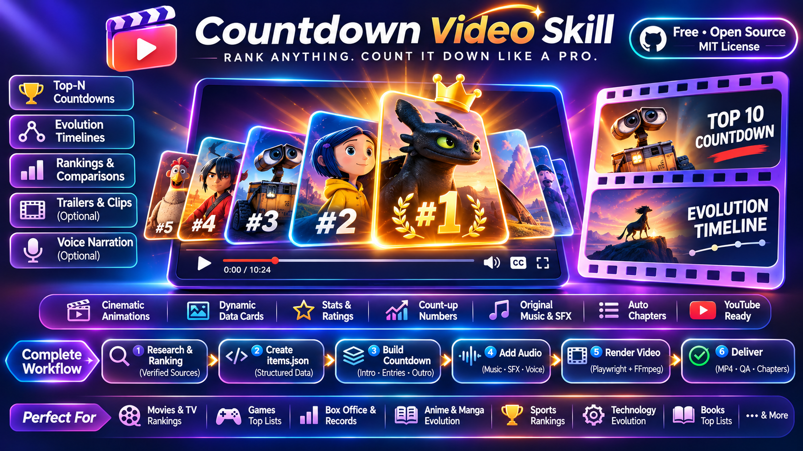
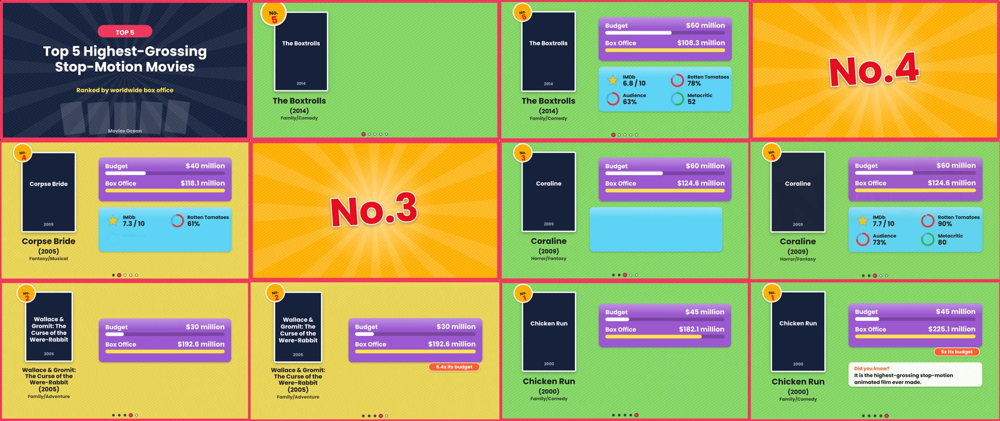

# Countdown Video Skill

[](https://github.com/i-smiling-buddha/countdown-video-skill/stargazers)
[](LICENSE)
[](https://agentskills.io)
[](https://skills.sh/i-smiling-buddha/countdown-video-skill)



**Rank anything. Count it down like a pro.**

> Top-N countdowns and year-by-year "evolution" videos, researched, animated and rendered by your AI agent.

हिंदी गाइड: [README.hi.md](README.hi.md)

Run a list channel ("Top 10 highest-grossing…", "Pixar evolution 1995–2024")? This open-source Agent Skill turns a topic into a finished 1080p MP4. Your agent researches the ranking with sources, writes `items.json`, and the engine renders an intro, a "No.X" or year slam before every entry, an animated card per entry, optional trailer clips, music, sound effects and an end screen. It also writes the YouTube chapters for your description.

Built for and battle-tested on the format of the [Movies Ocean](https://www.youtube.com/@mymoviesocean) channel, where the card + trailer evolution video was the channel's most-watched upload.

Useful for movie/anime/game list channels, box-office and ratings breakdowns, "evolution of…" videos, sports and records countdowns, and any faceless ranking channel.


## Install

Install with the open Agent Skills CLI:

```bash
npx skills add i-smiling-buddha/countdown-video-skill
```

Choose your target agent when prompted. See the [Skills directory](https://skills.sh) for the wider ecosystem.

**Claude Code plugin:**

```
/plugin marketplace add i-smiling-buddha/countdown-video-skill
/plugin install countdown-video-skill@countdown-video-skill
```

**Claude (claude.ai / desktop app):** zip the `skills/countdown-video` folder and upload it under **Settings → Capabilities → Skills**.

**Manual:** copy the `skills/countdown-video` folder into your agent's skills folder (`~/.claude/skills/`, or `.agents/skills/` for Codex, Copilot, Gemini CLI and Cursor).

## What it does

| Part | What you get |
|---|---|
| **Two modes** | `countdown`: No.N → No.1 with an orange "No.X" slam · `timeline`: oldest → newest with a big year card ("evolution" videos) |
| **Research** | Your agent looks up every number (Box Office Mojo, The Numbers, IMDb, Rotten Tomatoes, Metacritic) and keeps the source URLs in `items.json`; missing values are left out, never guessed |
| **Entry cards** | Image, title, year, genre · money stats that count up with comparison bars · a "5x its budget" pill · rating star and rings · a "Did you know?" fact · a progress tracker |
| **Trailer clips** | Optional full-screen clip after each card, letterboxed, with a "TRAILER · Title (Year)" lower third; music ducks under the trailer's own sound |
| **Sound** | Original upbeat music generated in code (copyright-free) or your own track · whoosh, hit, pop and tick effects timed to every reveal · optional voice for each rank |
| **End screen** | Clean slots for two YouTube end-screen videos and the Subscribe button |
| **YouTube chapters** | `0:00 No.5 …` timestamps ready to paste into the description (follows YouTube's 10-second rule) |
| **Your brand** | Default theme: green/yellow crayon-textured cards, red border, purple and blue boxes; every colour and timing is overridable |



*Demo: Top 5 highest-grossing stop-motion films (71 s). Posters show as title placeholders because studio images aren't shipped in this repo.*

## Example tasks

Ask your AI agent:

- *"Make a Top 10 highest-grossing anime movies countdown."*
- *"Make a LAIKA animation evolution video, 2005 to 2022, with a 25-second trailer after each film. The trailers are in `clips/`."*
- *"Top 7 lowest-rated Pixar movies on Rotten Tomatoes, with budget and box office."*
- *"Top 5 tallest buildings in the world"* (stats can be any label, like height and floors)
- *"Use my music track `bgm.mp3` and make the cards blue and white."*
- *"Re-render with Coraline's clip starting at 0:45."*

## Run the pipeline without an AI agent

Requirements: Python 3.10+, ffmpeg, and Chromium (installed through Playwright).

```bash
git clone https://github.com/i-smiling-buddha/countdown-video-skill
cd countdown-video-skill
pip install playwright soundfile scipy pillow
playwright install chromium

# put images in examples/stop-motion-top5/posters/ (optional), then:
bash skills/countdown-video/scripts/make_countdown.sh examples/stop-motion-top5/items.json top5.mp4

# your own music, quieter under trailers:
bash skills/countdown-video/scripts/make_countdown.sh items.json out.mp4 2 -- --music bgm.mp3 --clip-music 0.1
```

| Script | Purpose |
|---|---|
| `build_countdown.py` | `items.json` → renderable page, timeline, SFX cues, YouTube chapters; flags missing images and clips |
| `render.py` | Deterministic frame-range renderer (Playwright → H.264) |
| `compose_clips.py` | Lays trailer clips into the video with lower thirds and extracts their audio |
| `countdown_audio.py` | Music (generated or yours), SFX, trailer audio with ducking, optional voice |
| `make_countdown.sh` | Whole pipeline → `out.mp4`, `out_sheet.png` (QA), `out_chapters.txt` |

The full `items.json` schema is in [`skills/countdown-video/SKILL.md`](skills/countdown-video/SKILL.md); two ready examples are in [`examples/`](examples).

## Compatibility

This repository follows the open [Agent Skills](https://agentskills.io) format. It works in compatible agents such as Claude, Claude Code, OpenAI Codex, GitHub Copilot, Gemini CLI and Cursor. Exact support and installation locations vary by tool.

The agent needs **code execution** with Python, ffmpeg and a headless Chromium. For a chat app without a skill loader, paste `skills/countdown-video/SKILL.md` at the top of the chat. It will research and write `items.json`, but rendering needs an agent that can run code.

## Important limitations

- **Images and trailers are yours to supply.** The skill never downloads posters or trailers. Without them it renders title placeholders and skips clips, so you can preview first.
- **Trailers can get Content ID claims** on YouTube. Using them is the channel owner's decision.
- **Numbers are only as good as the sources.** Box office figures differ between sites; the skill keeps one source per metric and records the URLs, but check them before publishing.
- **Rendering takes time.** Roughly 3 seconds of wall time per second of video per CPU core at 1080p (trailer segments are composited much faster).
- **16:9 only for now.** A vertical Shorts layout is not included yet.

**Brand note:** ratings are shown as plain text labels (IMDb, Rotten Tomatoes, Metacritic) with generic star and ring graphics, not the sites' logos.

## Credits

- Format and default look based on the countdown and evolution videos of the [Movies Ocean](https://www.youtube.com/@mymoviesocean) channel.
- Rendering engine adapted from [PPT Animation Skill](https://github.com/i-smiling-buddha/ppt-animation-skill).
- [Playwright](https://playwright.dev) and [FFmpeg](https://ffmpeg.org) for rendering.

## More free skills by Smiling Buddha

- **[PPT Animation Skill](https://github.com/i-smiling-buddha/ppt-animation-skill)** — turn any topic into a Kurzgesagt-style animated explainer video: your agent writes the script, records an offline Hindi/English voiceover, animates every scene in SVG and renders a 1080p MP4, with no paid APIs. `npx skills add i-smiling-buddha/ppt-animation-skill`
- **[Smart Model Router Skill](https://github.com/i-smiling-buddha/smart-model-router-skill)** — save tokens and API credits: your agent routes each coding task to the cheapest model that can reliably do it, verifies the result, and escalates only when it fails. `npx skills add i-smiling-buddha/smart-model-router-skill`
- **[AI Image Recognition Skill](https://github.com/i-smiling-buddha/ai-image-recognition-skill)** — stop guessing from previews: your agent checks real transparency (catches fake checkerboards), true format, size/DPI, colors, blur and GPS metadata in the actual image file. `npx skills add i-smiling-buddha/ai-image-recognition-skill`
- **[Reflection Skill](https://github.com/i-smiling-buddha/reflection-skill)** — recreate any app, website, game or software, clean-room: your agent studies it from the outside, maps every screen, flow and data table, then builds a better version under your own brand. `npx skills add i-smiling-buddha/reflection-skill`

## Contributing

Issues, bug reports, new themes, card layouts, example `items.json` files and pull requests are welcome. Please don't upload posters, trailers or other copyrighted media. See [CONTRIBUTING.md](CONTRIBUTING.md) for guidelines.

## License

MIT. Made by [Smiling Buddha](https://github.com/i-smiling-buddha) · [DESITechnology](https://desitechnology.com).
